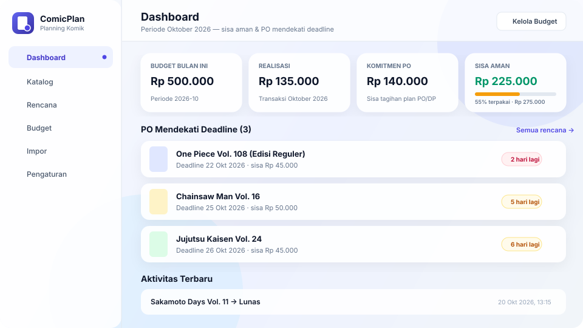
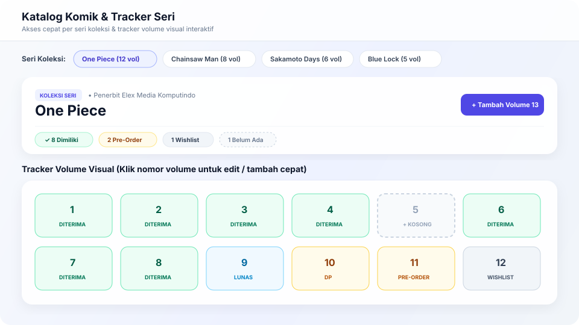
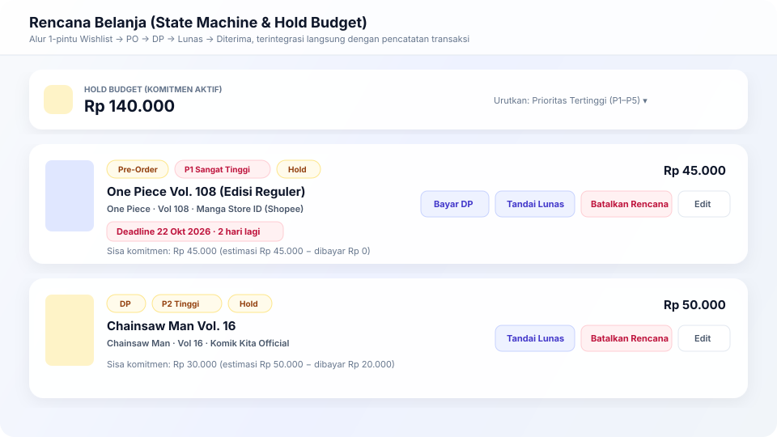

<div align="center">
  
  <h1>ComicPlan</h1>
  <p><strong>Personal Manga &amp; Comic Purchasing Planner — Shopee PO Sync, Series Volume Tracker &amp; Monthly Budget Hold</strong></p>

  <p>
    <a href="https://comic-planner.vercel.app"><strong>🌐 Live Preview</strong></a> ·
    <a href="#tampilan-aplikasi-live-preview">Screenshots</a> ·
    <a href="#fitur-utama">Fitur Utama</a> ·
    <a href="#panduan-setup--deploy-vercel">Setup &amp; Deploy</a> ·
    <a href="#userscript-tampermonkey-shopee">Tampermonkey Sync</a>
  </p>
</div>

---

## Ringkasan

**ComicPlan** adalah aplikasi web personal (single-user) untuk merencanakan dan melacak pembelian komik/manga fisik maupun pre-order (PO) dari toko Shopee target. Aplikasi ini menggabungkan **katalog & visual tracker volume per seri**, **state machine rencana belanja (`wishlist` → `po` → `dp` → `lunas` → `diterima` / `batal`)**, **perhitungan otomatis komitmen/hold budget bulanan**, serta **impor 1-klik langsung dari etalase Shopee via Tampermonkey userscript**.

---

## Tampilan Aplikasi (Live Preview)

> **Live Demo:** [https://comic-planner.vercel.app](https://comic-planner.vercel.app) *(ganti dengan URL Vercel produksi Anda setelah deploy)*

### 1. Dashboard — Ringkasan Sisa Aman & PO Mendekati Deadline


### 2. Katalog & Tracker Volume Visual Per Seri


### 3. Rencana Belanja — State Machine, Hold Budget & Pencatatan Transaksi 1-Langkah


---

## Fitur Utama

- **Dashboard Sisa Aman & Countdown Deadline PO**:
  - Menghitung otomatis `Sisa Aman = Total Budget − Realisasi Bulan Ini − Komitmen PO/DP`.
  - Menampilkan daftar PO yang mendekati deadline (`H-7`) dengan klik langsung ke filter rencana terkait.
  - Memberikan rekomendasi pelepasan hold berdasarkan prioritas terendah ketika sisa aman bernilai negatif.
- **Katalog Komik & Tracker Volume Per Seri (`/katalog` & `/katalog/seri/[seri]`)**:
  - Bar chip **Seri Koleksi** (`One Piece (12 vol)`) untuk melompat langsung ke tracker volume per seri.
  - Grid nomor volume interaktif (`1..N`) yang menandai volume dimiliki, PO/DP, wishlist, atau volume yang masih bolong (klik kotak kosong untuk langsung menambah volume tersebut).
  - Filter status, tipe komik, pencarian, dan urutan tersimpan di URL query string (tidak hilang saat refresh atau klik tombol Back).
- **Rencana Belanja Satu Pintu (`/plans`)**:
  - State machine tervalidasi di aplikasi & trigger PostgreSQL (`wishlist` → `po` → `dp` → `lunas` → `diterima` / `batal`).
  - **Transisi + Transaksi 1-Langkah**: Saat mengubah status ke `DP` atau `Lunas`, Anda dapat langsung mencatat nominal pembayaran dalam satu modal tanpa berpindah halaman.
  - Edit cepat **Prioritas (`#1`–`#5`)**, **Estimasi Harga**, **Listing Toko**, dan **Deadline PO**, disertai pengurutan berdasarkan prioritas, deadline terdekat, atau sisa tagihan terbesar.
- **Budget & Riwayat Transaksi (`/budget`)**:
  - Pengaturan alokasi budget per periode (`YYYY-MM`) dengan indikator pemakaian real-time.
  - Pencatatan transaksi (`DP`, `Pelunasan`, `Bayar Penuh`, `Refund`) dan fitur hapus transaksi dengan konfirmasi inline.
- **Sinkronisasi Shopee via Tampermonkey (`/import` & `/api/import`)**:
  - Ekstraksi produk & status PO dari halaman toko Shopee menggunakan userscript Tampermonkey atau uji coba payload JSON manual.
  - Deduplikasi otomatis berdasarkan `(marketplace, shop_id, item_id_shopee)`.
- **Pengaturan & Backup Data (`/settings`)**:
  - Manajemen kredensial `IMPORT_TOKEN`, daftar toko Shopee terlacak, dan ekspor data ke **CSV** (`items`, `plans`, `transactions`) maupun **Backup JSON Lengkap**.

---

## Tech Stack

- **Framework**: Next.js 16 (App Router, Server Actions, React 19)
- **Language & Styling**: TypeScript 5, Tailwind CSS 4 (Indigo Glassmorphism, Mobile-First)
- **Database & Auth**: Supabase (PostgreSQL, Row Level Security, Single-User Guard Trigger)
- **Icons & Testing**: Lucide React, Node.js Native Test Runner (`node --test`)

---

## Panduan Setup & Deploy Vercel

### 1. Install Dependencies
```bash
npm install
```

### 2. Setup Database Supabase
1. Buat project baru di [Supabase Dashboard](https://supabase.com).
2. Buka menu **SQL Editor**, salin seluruh isi [`supabase/schema.sql`](supabase/schema.sql), lalu klik **Run**.
3. Skema ini membuat 6 tabel (`budgets`, `items`, `listings`, `plans`, `transactions`, `status_history`), mengaktifkan **RLS**, memasang trigger validasi transisi status (`guard_plan_status_transition`), audit trail (`log_plan_status_change`), serta guard single-user (`prevent_extra_user_signups`).

### 3. Konfigurasi Auth Single-User di Supabase
1. Buka **Authentication → Providers → Email**, lalu matikan **"Allow new users to sign up"**.
2. Buka **Authentication → Users → Add User** untuk membuat 1 akun email pemilik.

### 4. Konfigurasi Environment Variables
Salin `.env.example` menjadi `.env.local`:
```bash
cp .env.example .env.local
```

Isi ke-5 variabel berikut (baik di `.env.local` maupun di dashboard **Vercel → Project Settings → Environment Variables**):
```env
NEXT_PUBLIC_SUPABASE_URL=https://your-project-id.supabase.co
NEXT_PUBLIC_SUPABASE_ANON_KEY=eyJhbGciOiJIUzI1NiIsInR5cCI...
SUPABASE_SERVICE_ROLE_KEY=eyJhbGciOiJIUzI1NiIsInR5cCI...
IMPORT_TOKEN=ganti_dengan_token_rahasia_anda
ALLOWED_USER_EMAIL=owner@example.com
```

### 5. Menjalankan Secara Lokal
```bash
npm run dev
```
Buka [http://localhost:3000](http://localhost:3000).

### 6. Deploy ke Vercel
1. Buka [vercel.com/new](https://vercel.com/new) dan impor repositori GitHub ini.
2. Masukkan 5 Environment Variables di atas lalu klik **Deploy**.
3. Setelah mendapatkan domain Vercel (misal `https://comic-planner.vercel.app`), tambahkan URL tersebut ke **Supabase Dashboard → Authentication → URL Configuration** (`Site URL` & `Redirect URLs`).

---

## Endpoint Impor (`POST /api/import`)

Endpoint ini menerima batch produk Shopee dari userscript Tampermonkey menggunakan header `X-Import-Token`.

| Header | Nilai |
|---|---|
| `Content-Type` | `application/json` |
| `X-Import-Token` | Sama persis dengan `IMPORT_TOKEN` di environment server |

**Contoh Payload:**
```json
{
  "items": [
    {
      "itemid": "987654321",
      "shopid": "555000111",
      "nama": "One Piece Vol. 108 (Edisi Indonesia)",
      "harga_raw": 4500000000,
      "label_po": true,
      "deadline_po": "2026-12-01",
      "thumbnail": "https://down-id.img.susercontent.com/...",
      "url": "https://shopee.co.id/product/555000111/987654321",
      "nama_toko": "Manga Store ID",
      "seri": "One Piece",
      "volume": 108
    }
  ]
}
```

---

## Userscript Tampermonkey Shopee

1. Pasang ekstensi [Tampermonkey](https://www.tampermonkey.net/) di browser desktop atau Kiwi Browser (Android).
2. Buka halaman **`/import`** di aplikasi ComicPlan, lalu klik **Salin Script Tampermonkey** atau **Unduh `.user.js`** (tersedia juga di [`userscript/comicplan-import.user.js`](userscript/comicplan-import.user.js)).
3. Buka halaman toko Shopee, klik ikon **⚙️** pada panel mengambang **ComicPlan Sync**, lalu tempel **URL Endpoint** dan **Import Token**.
4. Centang komik yang ingin dimasukkan ke katalog & wishlist, lalu klik **Sync ke ComicPlan**.

---

## Skrip yang Tersedia

- `npm run dev` — Menjalankan server development Next.js
- `npm run build` — Memeriksa tipe TypeScript dan membuat production build
- `npm run start` — Menjalankan production server
- `npm run lint` — Menjalankan pemeriksaan ESLint
- `npm test` — Menjalankan seluruh unit test (`node --test tests/*.test.ts`)
